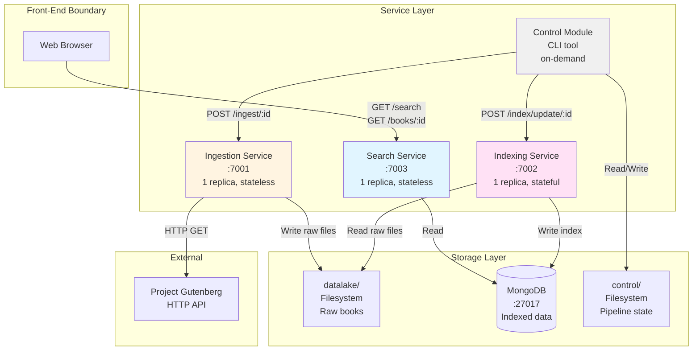
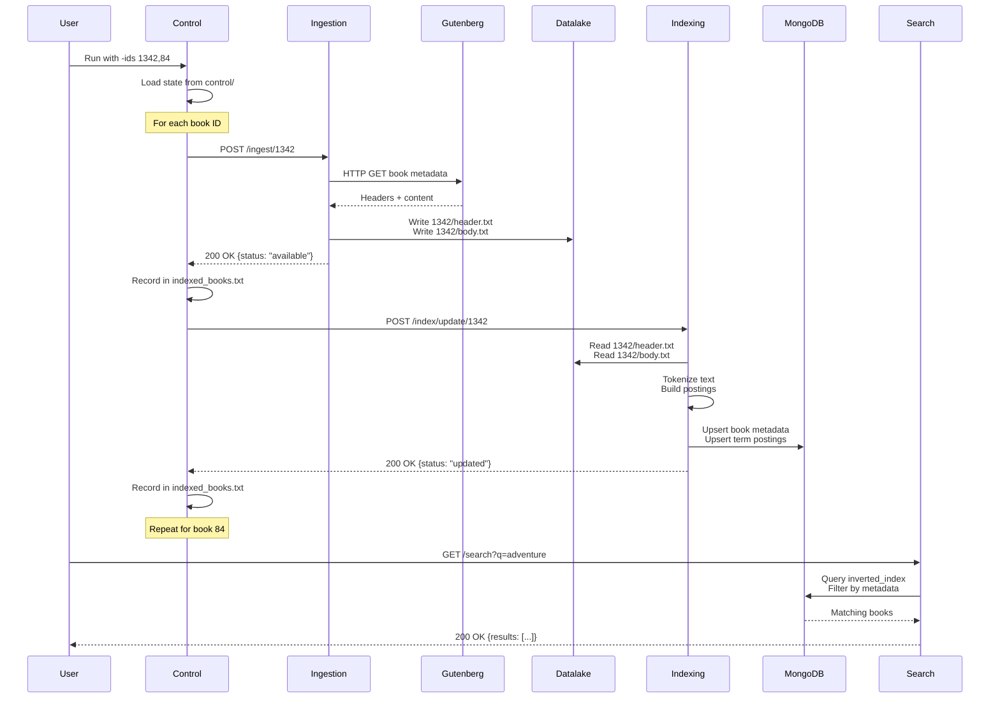
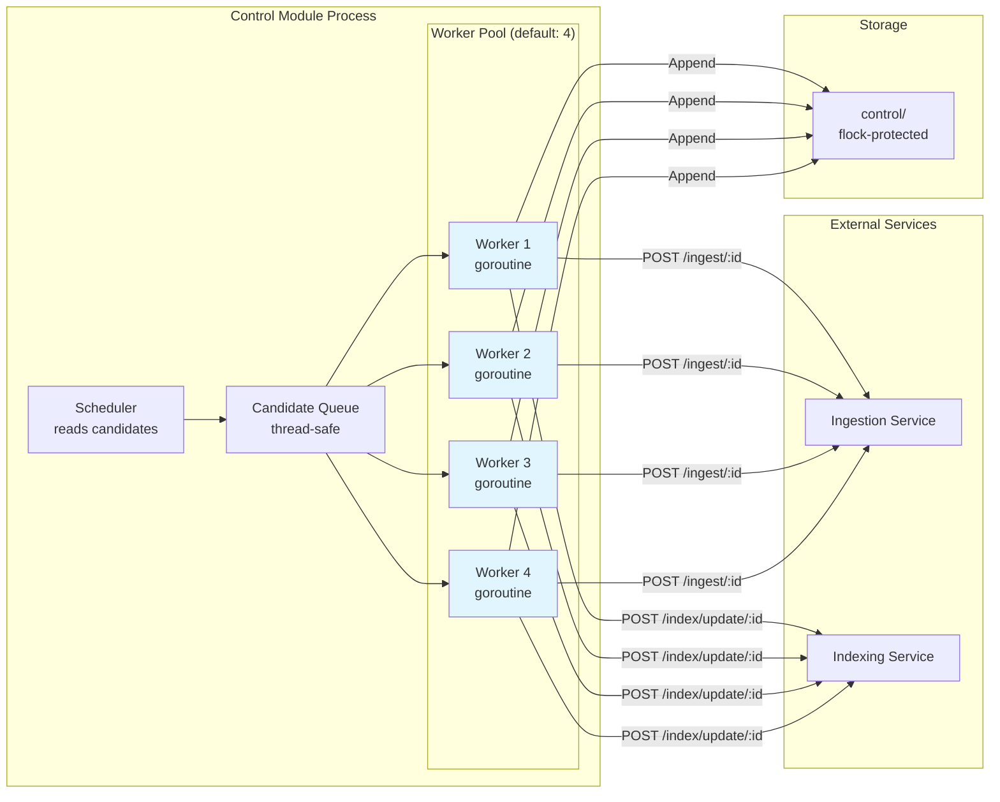
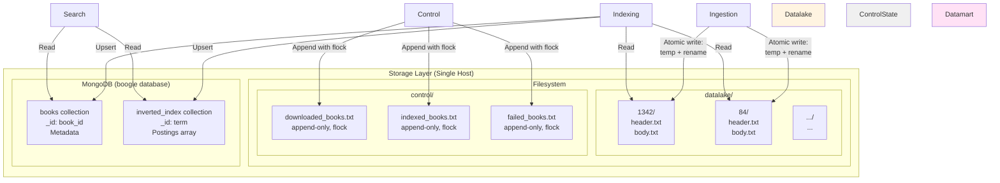
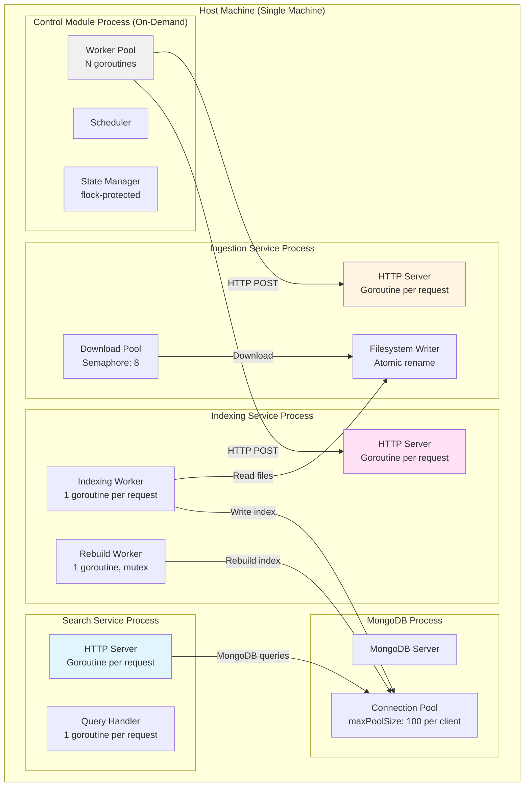
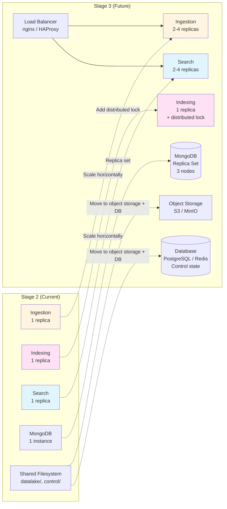

# Architecture Diagrams

This document contains architecture diagrams for the Boogle Engine Stage 2 system. These diagrams illustrate the service boundaries, data flow, concurrency model, and storage architecture.

## System Overview

## Data Flow: Ingestion to Search

## Concurrency Model: Control Module Workers

## Storage Architecture

## Service Interaction and Thread Boundaries

## Stage 3 Migration: What Changes

## Key Architectural Decisions

### 1. Classical HTTP Orchestration (No Message Broker)

**Decision:** Control Module coordinates services via direct HTTP calls.

**Rationale:**
- Simpler deployment (no Kafka/RabbitMQ infrastructure)
- Easier debugging (synchronous request-response)
- Adequate for single-host Stage 2

**Trade-off:**
- Control Module is a single point of failure
- Cannot scale control horizontally without distributed coordination

### 2. Filesystem-Based Datalake and Control State

**Decision:** Use local filesystem with atomic writes (temp file + rename) and flock.

**Rationale:**
- Simple, no external dependencies
- Fast for single-host deployment
- Crash-safe with atomic operations

**Trade-off:**
- Cannot share across multiple hosts in Stage 3
- Must migrate to object storage (S3) and database

### 3. Single-Replica Indexing with In-Process Lock

**Decision:** Indexing service runs as single replica, rebuild serialized with mutex.

**Rationale:**
- Simpler implementation
- No distributed lock needed for Stage 2

**Trade-off:**
- Cannot scale indexing horizontally
- Must add distributed lock (MongoDB document, Redis, etcd) for Stage 3

### 4. MongoDB as Datamart

**Decision:** Use MongoDB for inverted index and metadata storage.

**Rationale:**
- Flexible schema for book metadata
- Good support for array fields (postings)
- Driver available for Go

**Trade-off:**
- Posting arrays may hit 16MB document limit at scale
- Full array rewrite on each update (expensive for large postings)
- Stage 3: consider sharding or alternative data model (one doc per term-book pair)

### 5. Worker Pool in Control Module

**Decision:** Configurable worker pool (default: 4) with goroutines.

**Rationale:**
- Concurrency without complexity of async programming
- Easy to tune via `-workers` flag

**Trade-off:**
- Optimal value depends on workload (benchmark shows 8 is best)
- Beyond optimal, contention reduces gains

## Thread Safety Summary

| Component | Mechanism | Scope | Stage 3 Impact |
|-----------|-----------|-------|----------------|
| Control state files | flock (Unix) / LockFileEx (Windows) | Cross-process | Must move to database |
| Datalake writes | Atomic rename (temp + final) | Cross-process | Must move to object storage |
| MongoDB writes | Driver connection pool + transactions | Cross-process | Scale with replica set |
| Indexing rebuild | In-process mutex | Single process | Must add distributed lock |
| Ingestion downloads | Semaphore (counting) | Single process | Scale with replicas |
