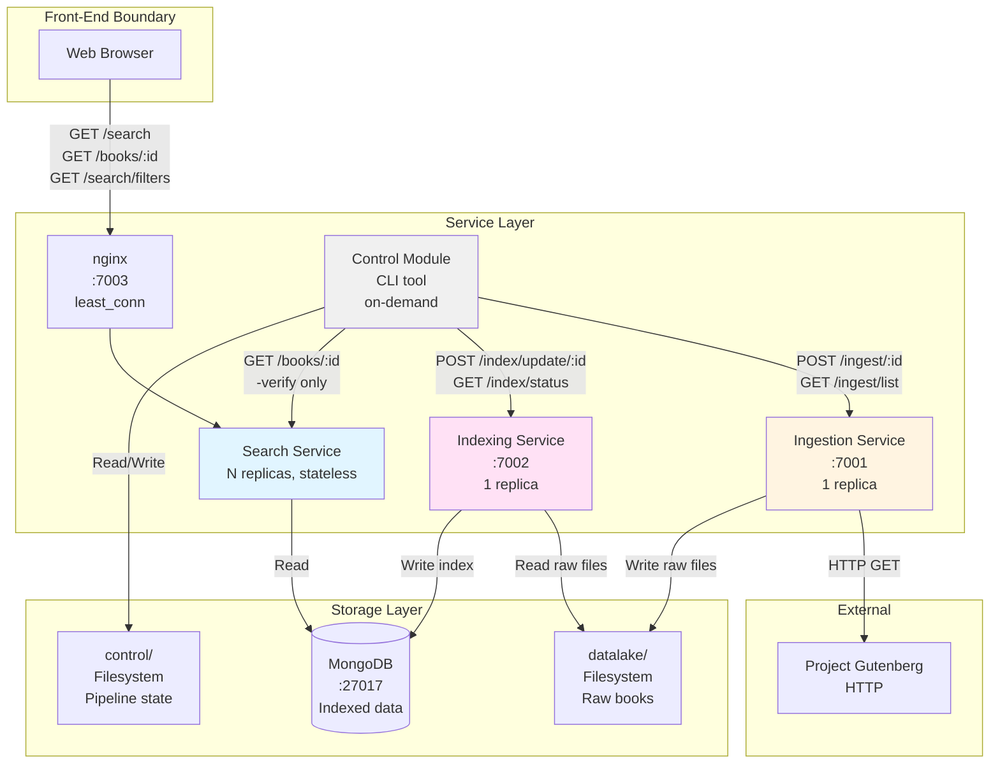
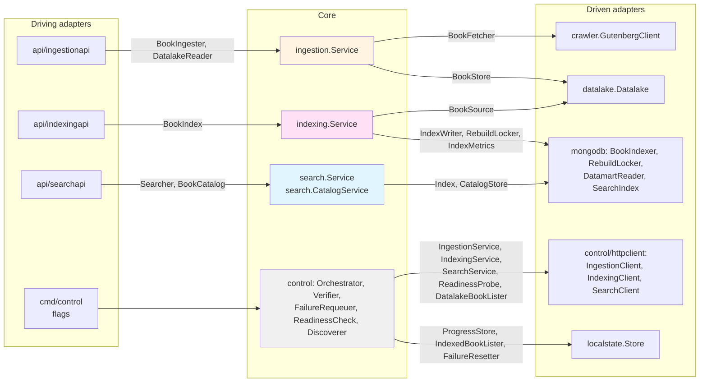
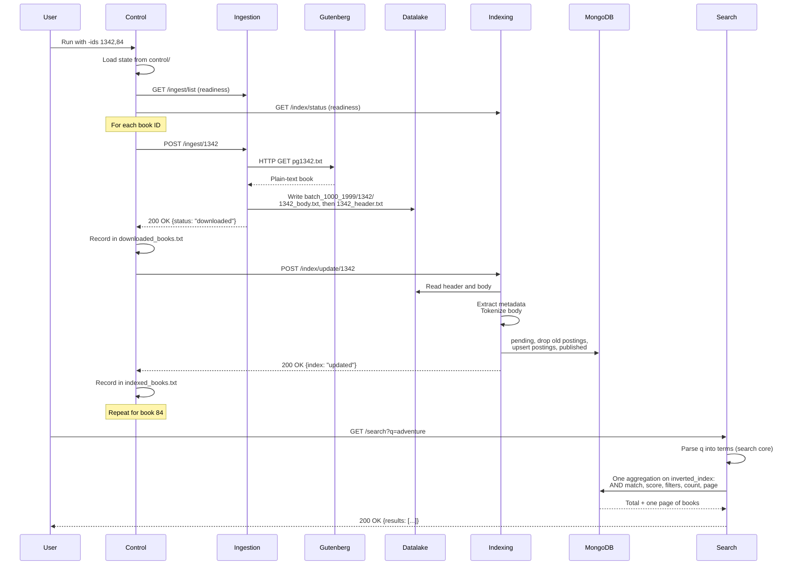
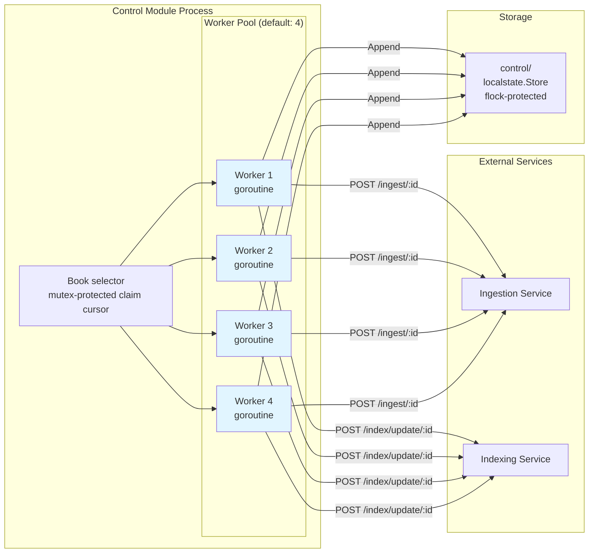
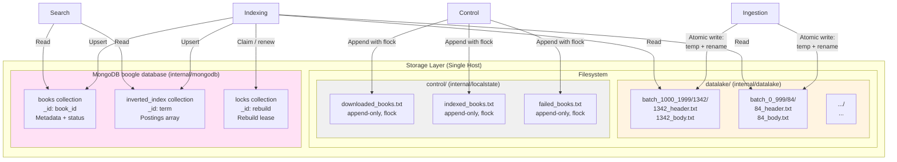
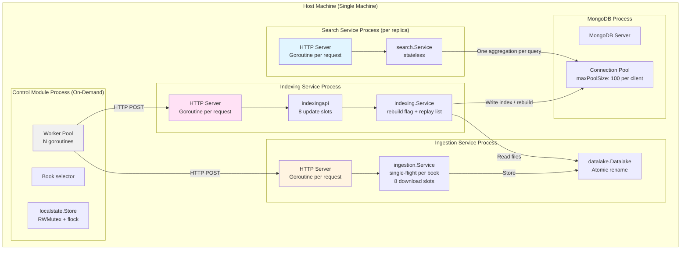
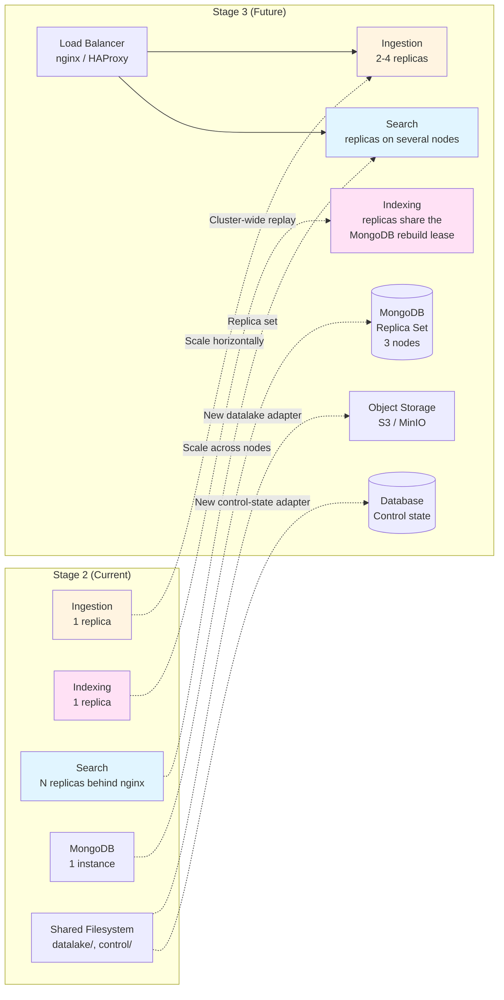

# Architecture

This document describes the architecture of Boogle Engine Stage 2 at two levels:

- **System level**: the processes (Ingestion, Indexing and Search Services, Control Module), the stores they share (datalake, MongoDB datamart, control state) and how they talk to each other.
- **Code level**: the hexagonal (ports and adapters) layout of the Go module, in which each use case lives in a core package that declares the interfaces it needs, and every technology (HTTP, MongoDB, the filesystem, Project Gutenberg) sits in an adapter behind one of those interfaces.

## System Overview



## Code Structure: Hexagonal Layout

Every process is built from the same three kinds of package:

- **Core** packages hold the domain model and the use cases. They declare, as Go interfaces, both the operations they offer (*driving ports*) and the operations they need from the outside world (*driven ports*). They import no HTTP, MongoDB or filesystem code.
- **Adapters** connect a core to a technology. *Driving adapters* (the HTTP handlers, the command line) call a core through its driving ports; *driven adapters* (MongoDB, the datalake, the Gutenberg client, the HTTP clients of the Control Module, the control-state files) implement its driven ports.
- **Composition roots** (`cmd/*`) read the configuration, construct the adapters, inject them into the core constructors and serve. They contain no business rules.

### Packages by layer

| Layer | Package | Responsibility |
|---|---|---|
| Core: domain | `internal/models` | Domain types (`BookID`, `Book`, `StoredBook`, `BookMetadata`, `IndexBookInput`, `IngestionResult`, `FilterValues`) and the cross-boundary errors (`ErrBookNotFound`, `ErrBookUnavailable`, `ErrTransient`, `ErrPermanent`). No struct tags, no imports outside the standard library. |
| Core: domain | `internal/indexer` | Tokenizer (`Tokenize`, `Normalize`, `ProcessText`) and metadata parser (`ExtractMetadata`), shared by indexing and search so a query term is normalized exactly like an indexed term. |
| Core: use case | `internal/ingestion` | `ingestion.Service`: one shared download per book (single-flight), bounded download slots, a per-ingestion budget, retries of transient failures, and the already-stored check that answers `available` without downloading. |
| Core: use case | `internal/indexing` | `indexing.Service`: index one book, rebuild the whole index under a cross-replica lease with replay of the updates made during the rebuild, report index statistics. Owns `ErrRebuildInProgress`, `IndexStats`, `RebuildReport`. |
| Core: use case | `internal/search` | `search.Service`: query parsing into at most 10 distinct terms, paging and year rules, filter normalization, and the empty-terms short-circuit. `search.CatalogService`: one published book and the `GET /search/filters` values. |
| Core: use case | `internal/control` | Orchestrator (worker pool, book selector, retries with backoff), `Verifier` (`-verify`), `FailureRequeuer` (`-retry-failed`), `ReadinessCheck`, `Discoverer` (`-discover`). |
| Driving adapter | `internal/api` | Shared HTTP kit used by the three APIs: `ErrorResponse`, `WriteJSON`, `ParseBookIDPath`, `WriteInvalidBookID`, `InternalErrorCode`, `InvalidBookIDCode`, `BookNotFoundCode`. Test helpers live in `internal/api/apitest`. |
| Driving adapter | `internal/api/ingestionapi` | Ingestion API handlers (`POST /ingest/{book_id}`, `GET /ingest/status/{book_id}`, `GET /ingest/list`) and their response types. |
| Driving adapter | `internal/api/indexingapi` | Indexing API handlers (`POST /index/update/{book_id}`, `POST /index/rebuild`, `GET /index/status`), including the slot queue that bounds concurrent updates. |
| Driving adapter | `internal/api/searchapi` | Search API handlers (`GET /search`, `GET /books/{book_id}`, `GET /search/filters`) and the CORS policy; only this API is browser-facing. |
| Driving adapter | `cmd/control` (flags) | Turns command-line flags into calls to the control use cases. |
| Driven adapter | `internal/crawler` | `GutenbergClient` (implements `ingestion.BookFetcher`) and the header/body splitter. |
| Driven adapter | `internal/datalake` | Batch folder layout, atomic file writes, listing of complete books (implements `ingestion.BookStore` and `indexing.BookSource`). |
| Driven adapter | `internal/mongodb` | Datamart: connection, schema and indexes, write path, rebuild and rebuild lease, readers and the search aggregation (implements the driven ports of `indexing` and `search`). |
| Driven adapter | `internal/control/httpclient` | HTTP clients of the three service APIs (implement the service ports of `control`) and their wire types. |
| Driven adapter | `internal/localstate` | The `flock`-protected control-state files (implements the progress ports of `control`). |
| Composition root | `cmd/ingestion`, `cmd/indexing`, `cmd/search`, `cmd/control` | Configuration, wiring, HTTP server, graceful shutdown. |

### Ports and the adapters that implement them



Arrows show the direction of calls, labelled with the port used; every core also uses the shared domain packages `internal/models` and `internal/indexer`. Source-code dependencies all point **into** the core: a driving adapter imports the core to call it, and a driven adapter imports the core to implement its interfaces. No core package imports an adapter.

| Core | Driving ports (offered) | Driven ports (required) | Implemented by |
|---|---|---|---|
| `ingestion` | `BookIngester` (`Ingest`), `DatalakeReader` (`Locate`, `ListBookIDs`) | `BookFetcher` | `crawler.GutenbergClient` |
| | | `BookStore` | `datalake.Datalake` |
| `indexing` | `BookIndex` (`IndexBook`, `Rebuild`, `Stats`) | `BookSource` | `datalake.Datalake` |
| | | `IndexWriter` (with the `NextBook` stream) | `mongodb.BookIndexer` |
| | | `RebuildLocker` / `RebuildLease` | `mongodb.RebuildLocker` (lease in the `locks` collection) |
| | | `IndexMetrics` | `mongodb.DatamartReader` |
| `search` | `Searcher` (`Search`), `BookCatalog` (`PublishedBook`, `FilterOptions`) | `Index` | `mongodb.SearchIndex` |
| | | `CatalogStore` | `mongodb.DatamartReader` |
| `control` | none: `cmd/control` calls the use-case types directly | `IngestionService`, `ReadinessProbe`, `DatalakeBookLister` | `httpclient.IngestionClient` |
| | | `IndexingService`, `ReadinessProbe` | `httpclient.IndexingClient` |
| | | `SearchService` | `httpclient.SearchClient` |
| | | `ProgressStore`, `IndexedBookLister`, `FailureResetter` | `localstate.Store` |

### Rules the layout enforces

- **Ports belong to the core that consumes them.** Every interface outside test files is declared in a core package; the only exception is the unexported test seam `mongodb.booksSearcher`.
- **Adapters prove their ports at compile time.** Each driven adapter has a small `ports.go` with assertions such as `var _ search.Index = SearchIndex{}`, so a change to a port breaks the adapter's build instead of failing at run time.
- **Core constructors reject missing ports.** `indexing.NewService` and `ingestion.NewService` return `ErrMissingPort`, `search.NewService` and `search.NewCatalogService` return `ErrMissingIndex` and `ErrMissingCatalogStore`, and the control constructors return `ErrMissingDependency`, so a wiring mistake fails at start-up.
- **Wire and storage shapes live in adapters.** `internal/models` has no struct tags. The JSON response types are declared in the handler packages (`searchapi.SearchResponse`, `indexingapi.RebuildResponse`, ...), the stored BSON shape in `mongodb` (`bookDocument`), and the decoded answers of the internal APIs in `control/httpclient` (`IndexStatus`, `BookList`).
- **Errors cross boundaries as core errors.** Adapters translate technology errors into the errors of `internal/models` or of the core they serve. For example, `mongodb.RebuildLocker` wraps the adapter-level `ErrRebuildLocked` into `indexing.ErrRebuildInProgress`, which `indexingapi` maps to `409`; the Gutenberg client classifies HTTP failures as `ErrTransient` or `ErrBookUnavailable`, which drive the retries in `ingestion.Service`.
- **Each binary links only what it serves.** A service binary links `internal/api` and its own handler package; `cmd/control` links none, and no binary links `apitest` or `testing`.

### Wiring: the composition roots

The roots are the only place where concrete adapters meet the core. The Search Service, from `cmd/search/main.go` and `cmd/search/catalog.go`:

```go
reader := mongodb.NewDatamartReader(client)
searchHandler, err := buildSearchHandler(mongodb.NewSearchIndex(reader)) // search.NewService(index) → searchapi.NewSearchHandler
catalogHandler, err := buildCatalogHandler(reader)                       // search.NewCatalogService(store) → searchapi.NewCatalogHandler
```

The Indexing Service, from `cmd/indexing/main.go`:

```go
indexing.NewService(indexing.Ports{
    Source:  lake,                            // datalake.Datalake
    Writer:  mongodb.NewBookIndexer(client),
    Locker:  mongodb.NewRebuildLocker(client),
    Metrics: mongodb.NewDatamartReader(client),
})
```

The Ingestion Service builds `ingestion.NewService(ingestion.Ports{Fetcher: client, Store: lake}, retry, limits)` with a `crawler.GutenbergClient` and a `datalake.Datalake`, and hands the service to `ingestionapi.NewIngestionHandler` as both its ingester and its datalake reader. `cmd/control` loads `localstate.Store`, builds the three `httpclient` clients, and passes them to the control use cases.

### Testing by layer

- **Cores** are tested with in-memory fakes of their driven ports (`internal/*/service_test.go`, `internal/control/*_test.go`), so retry, single-flight, rebuild-replay and orchestration rules run without a network or a database.
- **Driving adapters** test the HTTP contract (status codes, error bodies, CORS), either against the real core with a fake driven port behind it (`searchapi/stub_index_test.go` implements `search.Index`) or against a fake driving port. Shared assertions live in `internal/api/apitest`.
- **Driven adapters** are tested against the real technology: `internal/mongodb` against a live MongoDB (the tests skip when none is reachable), `control/httpclient` against `httptest` servers, `localstate` and `datalake` against temporary directories.

## Data Flow: Ingestion to Search



## Concurrency Model: Control Module Workers



## Storage Architecture



## Service Interaction and Thread Boundaries



## Stage 3 Migration: What Changes



The hexagonal layout turns most of these moves into adapter replacements. An object-storage datalake is a new adapter implementing `ingestion.BookStore` and `indexing.BookSource`; control state in a database is a new adapter implementing `control.ProgressStore`, `IndexedBookLister` and `FailureResetter`. The cores, the HTTP handlers and the API contracts stay as they are.

## Key Architectural Decisions

### 1. Classical HTTP Orchestration (No Message Broker)

**Decision:** Control Module coordinates services via direct HTTP calls.

**Rationale:**
- Simpler deployment (no Kafka/RabbitMQ infrastructure)
- Easier debugging (synchronous request-response)
- Adequate for single-host Stage 2

**Trade-off:**
- Control Module is a single point of failure
- Cannot scale control horizontally without distributed coordination

### 2. Filesystem-Based Datalake and Control State

**Decision:** Use local filesystem with atomic writes (temp file + rename) and flock.

**Rationale:**
- Simple, no external dependencies
- Fast for single-host deployment
- Crash-safe with atomic operations
- Both stores sit behind core ports (`internal/datalake`, `internal/localstate`), so replacing them does not touch the use cases

**Trade-off:**
- Cannot share across multiple hosts in Stage 3
- Must migrate to object storage (S3) and database

### 3. Rebuild Serialized by a Lease in MongoDB

**Decision:** `POST /index/rebuild` first claims a lease document in the `locks` collection (renewed every 30 s, expiring 2 minutes after a crash). Updates that arrive during a rebuild are recorded by the rebuilding process and replayed after the collections are swapped.

**Rationale:**
- The lease holds across every replica that shares the datamart, unlike an in-process mutex
- Updates are never blocked by a rebuild and never lost by its swap

**Trade-off:**
- The replay list is per process: with several Indexing replicas, updates must be routed to the lease holder or retried after the rebuild answers
- Stage 3 should move the replay bookkeeping into the datamart

### 4. MongoDB as Datamart

**Decision:** Use MongoDB for inverted index and metadata storage.

**Rationale:**
- Flexible schema for book metadata
- Good support for array fields (postings)
- Driver available for Go

**Trade-off:**
- Posting arrays may hit 16MB document limit at scale
- Full array rewrite on each update (expensive for large postings)
- Stage 3: consider sharding or alternative data model (one doc per term-book pair)

### 5. Worker Pool in Control Module

**Decision:** Configurable worker pool (default: 4) with goroutines.

**Rationale:**
- Concurrency without complexity of async programming
- Easy to tune via `-workers` flag

**Trade-off:**
- Optimal value depends on workload (benchmark shows 8 is best)
- Beyond optimal, contention reduces gains

### 6. Hexagonal Core with Explicit Ports

**Decision:** Each use case lives in a core package (`internal/ingestion`, `internal/indexing`, `internal/search`, `internal/control`) that declares its own driving and driven ports; HTTP, MongoDB, the filesystem and Gutenberg are adapters; `cmd/*` only wire them.

**Rationale:**
- Business rules (retries, single-flight, rebuild replay, query rules, orchestration) are tested with in-memory fakes, without a server
- A technology change for Stage 3 is a new adapter, not a rewrite of a service
- The API split (one handler package per service) keeps each binary limited to the code it serves

**Trade-off:**
- More packages and small interfaces to navigate
- Some rules are deliberately left in an adapter for performance (decision 7)

### 7. AND Matching and Relevance Ranking Run Inside the MongoDB Aggregation

**Decision:** The search core decides what a query *means* (terms, filters, page) and passes it through the `search.Index` port. Its evaluation is pushed down into one server-side aggregation in `internal/mongodb/search_reader.go`: the AND intersection of the posting lists, the relevance score (sum of the terms' `tf`, ties broken by ascending `book_id`), the published-only visibility, the filters, the total count and the requested page. This is a deliberate performance choice, not a gap in the layering.

**Rationale:**
- One round trip per query, and only one page of metadata crosses the network. Ranking in Go would require streaming every posting of every query term to the Search replica on each request, and the posting list of a common term covers most of the corpus.
- Postings are intersected before the `$lookup` into `books`, so each extra term shrinks the join instead of growing it.
- The total and the page come from the same `$facet`, so they are always consistent with each other.

**Trade-off:**
- The matching and ranking rules live in the MongoDB adapter, so a second `search.Index` adapter would have to re-implement them. The rules are documented as the port's contract in [mongodb.md](mongodb.md#searchrequest-semantics) and pinned by the live tests in `internal/mongodb/search_reader_test.go` (ranking by `tf`, tie-break by book ID, every term required, summed frequencies, pending books withheld, filters).

## Thread Safety Summary

| Component | Where | Mechanism | Scope | Stage 3 Impact |
|-----------|-------|-----------|-------|----------------|
| Control state files | `internal/localstate` | `sync.RWMutex` in memory; `flock` (Unix) / `LockFileEx` (Windows) on the files | Cross-process | Must move to database |
| Book claims | `internal/control` (book selector) | `sync.Mutex` on the claim cursor | Single process | Tasks collection with leases |
| Datalake writes | `internal/datalake` | Atomic rename (temp + `fsync` + final name) | Cross-process | Must move to object storage |
| Ingestion downloads | `internal/ingestion` | Single-flight map + `sync.Mutex`; buffered channel of 8 download slots | Single process | Scale with replicas |
| Index updates | `internal/api/indexingapi` | Buffered channel of 8 update slots | Single process | Scale with replicas |
| Rebuild replay | `internal/indexing` | `atomic.Bool` flag + `sync.Mutex` replay list | Single process | Move replay into the datamart |
| Rebuild exclusivity | `internal/mongodb` | Lease document in `locks`, claimed by a conditional update or an insert on its unique `_id` | Cross-replica | Already cluster-wide |
| MongoDB writes | `internal/mongodb` | Per-document atomic updates, idempotent upserts | Cross-process | Scale with replica set |
